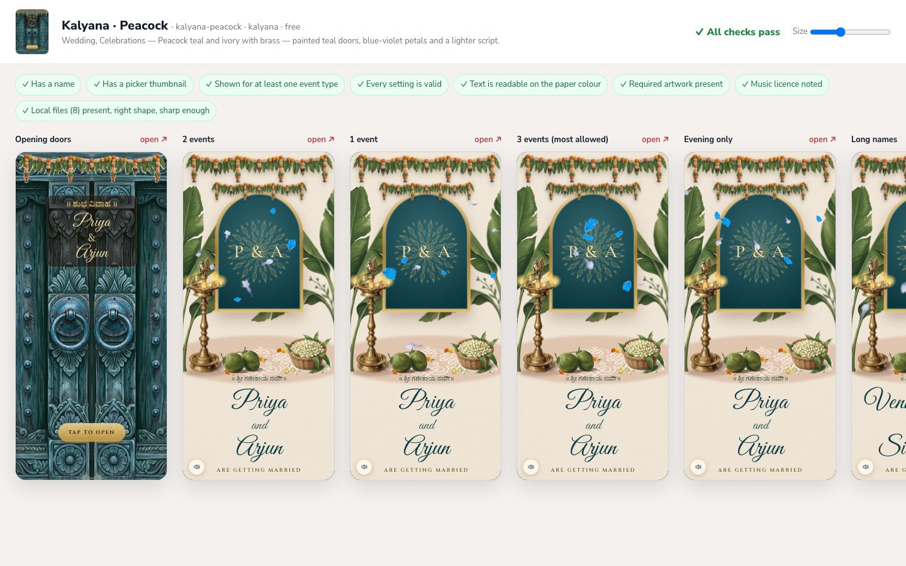

# Everso Invitation Design Kit

Make invitation designs for [Everso](https://everso.club): change the colours,
fonts, artwork, music and wording of an animated wedding invitation. Then
preview it on the real renderer and send it to us. Hosts will see your design
as a choice when they make an invitation in the Everso app.

No account, no Firebase and no app needed. You just need Node.js, which runs
the kit's tools; there's nothing else to install.



## Quick start

You need **[Node.js](https://nodejs.org) 20 or newer** (`node -v` shows your version).

```bash
git clone https://github.com/everso-club/invitation-design-kit.git
cd invitation-design-kit

npm run new -- my-design --from kalyana-peacock   # start from an example
npm run preview -- my-design                      # opens the browser, reloads as you save
npm run check -- my-design                        # the same checks Everso runs
npm run pack -- my-design                         # → submissions/my-design-<date>.zip
```

Then email the zip to us ([how to submit](docs/submitting.md)).

New to this? Start with **[Getting started](docs/getting-started.md)**. It
covers everything from installing Node.js onwards.

## How it works

An invitation has two layers:

| | What it is | Who makes it |
|---|---|---|
| **Engine** | The code that draws the invitation: its layout, the opening doors, scratch-to-reveal dates, falling petals, the RSVP. Today there is one engine, **Kalyana** (South Indian heritage). | Everso |
| **Design** | A `design.json` and its artwork that *dress* an engine: 13 colours, 3 fonts, 11 artwork pieces, the music, section titles, and which parts are on or off. | **You** |

A design can't move things around or add new animations. That's engine
work. If your idea needs it, describe it when you submit and we'll consider
it for a new engine.

```
designs/my-design/
├── design.json        name, author, settings (colours, fonts, art, wording…)
├── thumbnail.jpg      480×648, the card hosts see in the picker
├── door.webp          your artwork, referenced from design.json as "./door.webp"
└── petal-1.webp …
```

## Commands

| Command | What it does |
|---|---|
| `npm run new -- <id>` | Start `designs/<id>/` with every setting listed at its default. Add `--from <example>` to copy an example, artwork included. |
| `npm run preview -- <id>` | Open the preview: every sample invitation (1–3 events, long names, evening, invite-only, the opening doors) side by side, with the checks on top. Reloads whenever you save. `--port 5300` and `--no-open` are optional. |
| `npm run check -- <id>` | Run every check in the terminal. `--all` checks every design and example. |
| `npm run pack -- <id>` | Check, then write `submissions/<id>-<date>.zip` with only the files your design uses. |

`<id>` can also be a path to any design folder.

## What's in the kit

```
invitation-design-kit/
├── designs/       your designs (git-ignored, so they stay private)
├── examples/      kalyana-classic (the original look) · kalyana-peacock (new colours, fonts, art)
├── docs/          getting started · design guide · artwork · settings reference · submitting
├── tools/         the four commands: plain Node.js, no dependencies
├── engine/        what each engine lets a design set, and the checks (generated by Everso)
└── preview/       the prebuilt preview app and the engine's default artwork (generated by Everso)
```

## Documentation

- **[Getting started](docs/getting-started.md)**: install, first design, troubleshooting
- **[Design guide](docs/design-guide.md)**: `design.json`, colours, fonts, music, wording, quality bar
- **[Artwork](docs/artwork.md)**: shapes, transparency, making art with image models
- **[Settings reference](docs/spec.md)**: every setting, default and artwork size
- **[Submitting](docs/submitting.md)**: pack, send, review and credit

## Contributing

Designs are submitted by email, not as pull requests. That keeps your work
private until it's published. Improvements to the kit itself (docs, tools,
bug reports) are welcome: see [CONTRIBUTING.md](CONTRIBUTING.md). Please
follow our [Code of Conduct](CODE_OF_CONDUCT.md).

## Licence

Open source: you're free to use, copy, change and share this kit. A formal
licence will be added in a later version.
